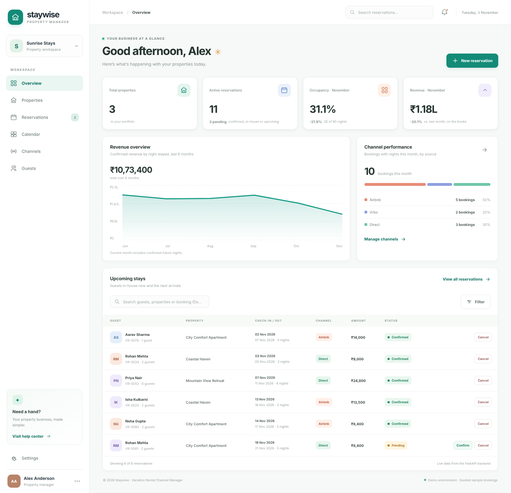
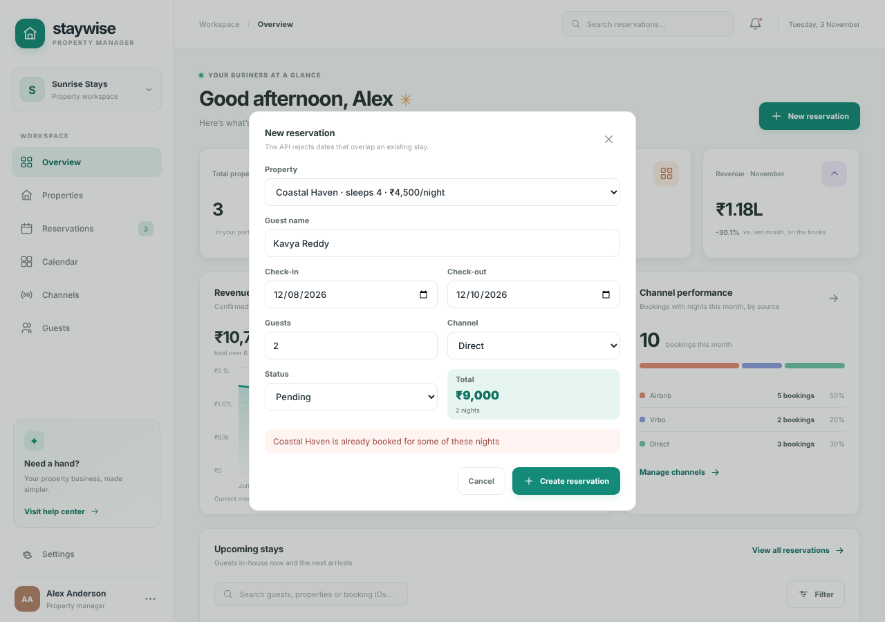

# Vacation Rental Channel Manager

## Project Overview

The Vacation Rental Channel Manager is a portfolio application inspired by property management systems used to manage vacation rental listings, reservations, pricing, and availability across multiple booking channels.

The goal is to build a working application from scratch and progressively implement DevOps practices.

## Project Objectives

- Build a property management dashboard.
- Manage properties and reservations.
- Track calendar availability, nightly rates, and minimum-stay rules.
- Simulate synchronization with Airbnb and Vrbo.
- Build an owner portal.
- Demonstrate invoices and payments using Stripe test mode.
- Implement automated testing, Docker, CI/CD, and monitoring.

## Screenshots





## Technology Stack

| Technology | Purpose | Status |
|---|---|---|
| React | Frontend | In use |
| Vite | Frontend development server | Configured |
| Node.js | JavaScript runtime | Installed |
| npm | Package management | Installed |
| Python | Backend development | Installed |
| FastAPI | Backend API | In use |
| SQLite | Development database | In use |
| PostgreSQL | Production database | Planned |
| pytest | Backend tests | In use |
| Docker | Containerization | Planned |
| Git and GitHub | Version control | In use |
| GitHub Actions | CI/CD | Planned |
| Stripe | Test payments | Planned |
| Prometheus and Grafana | Monitoring | Planned |
| Terraform and AWS | Optional cloud deployment | Planned |

## Project Structure

```text
vacation-rental-channel-manager/
├── backend/
│   ├── main.py            # FastAPI app factory, CORS, health check
│   ├── config.py          # Settings from environment variables / .env
│   ├── database.py        # SQLite schema, connections, demo seed data
│   ├── schemas.py         # Pydantic request and response models
│   ├── routers/           # properties, reservations, stats endpoints
│   ├── tests/             # pytest suite
│   └── .env.example
├── frontend/
│   ├── src/App.jsx        # Staywise dashboard
│   ├── src/api.js         # API client
│   └── .env.example
├── screenshots/
├── README.md
└── .gitignore
```

## Run Locally

You need Python 3.11+ and Node.js 20+.

### Backend

```bash
cd backend
python -m venv .venv
source .venv/bin/activate        # Windows: .venv\Scripts\activate
pip install -r requirements-dev.txt
uvicorn main:app --reload
```

The API runs at http://127.0.0.1:8000. Interactive docs are at http://127.0.0.1:8000/docs.

On first start the backend creates `vacation_rental.db` and seeds 3 properties with about six months of bookings around today's date. To start over, stop the server and delete the file.

### Frontend

In a second terminal:

```bash
cd frontend
npm install
npm run dev
```

Open http://localhost:5173/.

### Configuration

Copy `backend/.env.example` to `backend/.env` (and `frontend/.env.example` to `frontend/.env`) to change defaults.

| Variable | Default | Purpose |
|---|---|---|
| `DATABASE_PATH` | `backend/vacation_rental.db` | SQLite file location |
| `CORS_ORIGINS` | `http://localhost:5173,http://127.0.0.1:5173` | Frontend origins allowed to call the API |
| `SEED_DEMO_DATA` | `true` | Insert demo data into an empty database |
| `VITE_API_URL` | `http://127.0.0.1:8000` | Backend URL used by the dashboard |

### Tests

```bash
cd backend
pytest
```

## API

| Method | Path | Description |
|---|---|---|
| GET | `/health` | Service and database health |
| GET | `/api/properties` | List properties |
| GET | `/api/properties/{id}` | One property |
| GET | `/api/reservations` | List reservations. Filters: `status`, `property_id` |
| GET | `/api/reservations/{id}` | One reservation |
| POST | `/api/reservations` | Create a reservation. Returns 409 if the dates overlap an existing stay |
| PATCH | `/api/reservations/{id}` | Change status: Pending → Confirmed / Cancelled, Confirmed → Cancelled |
| GET | `/api/stats?month=YYYY-MM` | Occupancy, revenue, 6-month revenue trend and channel mix |

Booking rules enforced by the API:

- Check-out must be after check-in; stays are limited to 60 nights.
- Two stays at the same property overlap when each starts before the other ends. The check-out day is free for the next arrival.
- Cancelled reservations don't block dates. Cancelled is a final status.
- Guest count can't exceed the property's capacity.
- The total is calculated by the API from nights × nightly rate.
- Revenue and occupancy count confirmed nights only, split across months by the night they fall on.

## Development Roadmap

1. Initialize and document the project.
2. Build the React dashboard.
3. Implement the backend REST API.
4. Add database persistence.
5. Develop simulated Airbnb and Vrbo integrations.
6. Implement booking, calendar, and pricing workflows.
7. Build the owner portal and Stripe test payment workflows.
8. Add automated tests.
9. Containerize the application with Docker.
10. Implement CI/CD, security checks, and monitoring.
11. Document optional AWS deployment.

## Integration Limitations

Initial OTA integrations will use simulated adapters and test data. This does not establish a live connection to Airbnb or Vrbo. Real integrations require appropriate platform access, supported APIs, and permissions.

Payment demonstrations will use Stripe test mode.

## Security

- Never commit passwords, API keys, or access tokens.
- Keep environment files containing secrets out of Git.
- Use test credentials during development.
- Verify integrations before describing them as complete.

## Project Status

**Current phase:** Dashboard connected to a working reservations API with tests. Next: Docker.

### Completed

- React dashboard ("Staywise") with overview, reservations and properties pages.
- FastAPI backend split into routers, schemas, config and database modules.
- SQLite schema with constraints, foreign keys and a demo seed relative to today's date.
- Create, confirm and cancel reservations with double-booking prevention.
- Dashboard metrics, revenue chart and channel mix computed from real data by `/api/stats`.
- Configuration through environment variables.
- pytest suite covering health, listing, creation, overlap rules, status changes, validation and stats.

### Current Limitations

- Booking channels are simulated. Nothing connects to live Airbnb or Vrbo accounts.
- No authentication.
- Property photos are placeholders.
- Calendar, channels, guests and settings pages are placeholders.

### Next Steps

1. Dockerfiles for backend and frontend, and docker-compose with PostgreSQL.
2. GitHub Actions: run tests, build and push images.
3. Kubernetes manifests, Prometheus metrics and Grafana dashboards.
4. Terraform for AWS.
